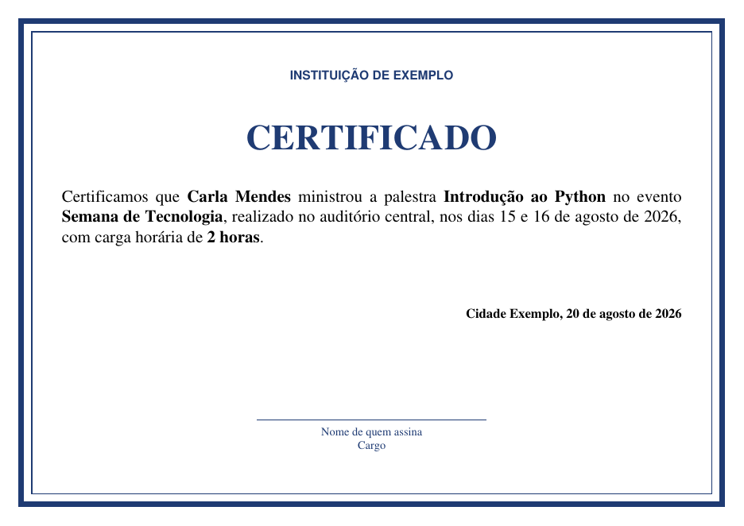

# Gerador de certificados

Gera certificados em PDF a partir de um modelo e de uma lista de participantes. Você escreve o texto uma vez, num arquivo de configuração, e o programa preenche um certificado para cada pessoa, em cima do seu próprio modelo.

- Funciona com qualquer modelo em PDF (feito no Canva, no Word etc.).
- Lê a lista de uma planilha em CSV ou pergunta os nomes no terminal.
- Tem um texto diferente para cada papel, por exemplo participante e ministrante.
- Confere a lista antes de gerar e aponta todas as linhas com problema de uma vez.
- Diminui a fonte quando o nome é longo e avisa se, mesmo assim, o texto não couber.



## Por que existe

Em cursos, palestras e semanas acadêmicas, os certificados costumam ser feitos um por um: abrir o modelo, trocar o nome, conferir o texto e exportar o PDF. Com 30 participantes por evento e alguns eventos por mês, isso toma horas, e cada cópia é uma nova chance de errar um nome ou esquecer alguém.

Este programa faz essa parte repetitiva. O texto é escrito e revisado uma vez só, e cada pessoa recebe o seu PDF.

## Instalação

Requer Python 3.11 ou mais recente.

```bash
git clone https://github.com/rosivjr/gerador-de-certificados.git
cd gerador-de-certificados
python3 -m venv .venv
source .venv/bin/activate
pip install .
```

## Uso rápido

A pasta [`exemplo`](exemplo) tem um modelo fictício, um evento e uma lista prontos:

```bash
cd exemplo
certificados validar evento.toml participantes.csv
certificados gerar evento.toml participantes.csv
```

Os PDFs ficam numa pasta com o nome do evento, `certificados_gerados/Semana_de_Tecnologia/`, com nomes como `certificado_participante_Ana_Souza.pdf`.

Para digitar os nomes em vez de usar uma planilha, omita a lista:

```bash
certificados gerar evento.toml
```

Se o evento tiver mais de um papel, o programa pergunta primeiro qual é e depois os nomes, um por vez. Deixe o nome vazio para terminar. Para gerar certificados de outro papel, rode o comando de novo.

## Como funciona

1. **Lê o evento.** O `evento.toml` é conferido logo no início: se o modelo existe, se as áreas e os tamanhos de fonte fazem sentido e se o texto de cada papel só usa campos conhecidos. Um erro aqui aparece antes de qualquer nome ser lido.
2. **Lê a lista.** Os participantes vêm do CSV ou são digitados no terminal.
3. **Confere todas as linhas.** Nome vazio, papel que não existe, campo exigido em branco e certificado repetido são apontados todos de uma vez, com o número da linha. Se houver qualquer erro, nenhum PDF é gerado, para não sobrar um lote pela metade.
4. **Monta o texto.** Os campos de cada pessoa preenchem o texto do papel. Um valor da planilha tem prioridade sobre o do evento.
5. **Desenha o PDF.** O texto é escrito numa página transparente, que depois é sobreposta à página do modelo. Se o texto não cabe na área, a fonte diminui meio ponto por vez até o tamanho mínimo; se ainda assim não couber, o programa não gera esse certificado e aponta a linha, em vez de cortar o texto.
6. **Salva.** Um arquivo por pessoa, numa pasta com o nome do evento. Um arquivo que já existe só é substituído com `--substituir`.

O código segue essas etapas, um módulo para cada uma, em [`src/certificados`](src/certificados):

| Módulo | Responsabilidade |
|---|---|
| `cli.py` | Comandos do terminal e ordem das etapas |
| `evento.py` | Leitura e conferência do `evento.toml` |
| `participantes.py` | Leitura do CSV |
| `interativo.py` | Perguntas no terminal quando não há CSV |
| `validacao.py` | Conferência das linhas da lista |
| `texto.py` | Preenchimento dos campos e negrito |
| `pdf.py` | Ajuste da fonte e desenho sobre o modelo |
| `nomes.py` | Nomes seguros para arquivos e pastas |
| `calibracao.py` | Grade usada pelo comando `calibrar` |

As bibliotecas são o [reportlab](https://www.reportlab.com/opensource/), que desenha o texto, e o [pypdf](https://pypdf.readthedocs.io/), que junta o texto ao modelo.

O motivo de cada escolha, como o uso dessas duas bibliotecas e a conferência de tudo antes de gerar, está em [`docs/decisoes.md`](docs/decisoes.md).

## Comandos

| Comando | O que faz |
|---|---|
| `certificados validar EVENTO LISTA` | Confere o evento e a lista sem gerar nada |
| `certificados gerar EVENTO [LISTA]` | Gera um PDF por linha; sem a lista, pergunta os nomes |
| `certificados calibrar EVENTO` | Cria `calibracao.pdf` com uma grade e as áreas sobre o modelo |

Opções do `gerar`: `--saida PASTA` escolhe a pasta dos PDFs, e `--substituir` permite sobrescrever arquivos que já existem. Use `certificados COMANDO --help` para ver todas.

O programa termina com código 0 quando tudo deu certo e 1 quando encontrou algum erro.

## O arquivo do evento

O arquivo TOML tem três partes. O [`exemplo/evento.toml`](exemplo/evento.toml) mostra todas, com comentários.

- **`[modelo]`**: o PDF do modelo, o tamanho da fonte (normal e mínimo) e as duas áreas onde o texto entra, `area_texto` e `area_data`.
- **`[evento]`**: nome, local, datas, carga horária, cidade e data de emissão.
- **`[papeis.NOME]`**: o texto de cada tipo de certificado. Campos entre chaves, como `{nome}`, são preenchidos para cada pessoa, e `*{nome}*` sai em negrito. A lista `exige` diz quais colunas a planilha precisa ter preenchidas para esse papel.

Os campos disponíveis no texto são `nome`, `papel`, `evento`, `local`, `datas`, `carga_horaria`, `cidade` e os que o papel exige. Um valor preenchido na planilha substitui o do evento; é assim que o ministrante recebe a carga horária da palestra, e não a do evento.

### Usando outro modelo

1. Copie o `exemplo/evento.toml` e troque o caminho em `arquivo`.
2. Rode `certificados calibrar evento.toml` e abra o `calibracao.pdf`.
3. Pela grade, ajuste `area_texto` e `area_data`. Os números são `[esquerda, topo, direita, base]`, em pontos, medidos a partir do canto superior esquerdo.
4. Repita até as caixas ficarem no espaço em branco do modelo.

## A lista de participantes

Um arquivo CSV com uma linha de cabeçalho. Ele pode ser separado por `;` (padrão do Excel em português) ou por `,`. No Excel ou no LibreOffice, salve como "CSV UTF-8".

```csv
nome;papel;tema;carga_horaria
Ana Souza;participante;;
Carla Mendes;ministrante;Introdução ao Python;2 horas
```

A coluna `nome` é obrigatória. A coluna `papel` só é necessária quando o evento tem mais de um papel. Quem participou com dois papéis aparece em duas linhas e recebe dois certificados.

## Status e limitações

Versão 1.0, de uso pelo terminal, testada no Ubuntu.

- O texto usa a fonte Times, que todo leitor de PDF já traz. Ela cobre os acentos do português e de outras línguas da Europa Ocidental, mas não letras como `ł` e `ż` (polonês) nem outros alfabetos, como o chinês. Essas letras saem como um quadrado preto.
- O programa não envia os certificados por e-mail nem os assina digitalmente.

Uma interface gráfica e o envio por e-mail estão planejados para a versão 2.0.

## Desenvolvimento

```bash
pip install -e ".[dev]"
pytest
ruff check .
ruff format --check .
```

## Licença

[MIT](LICENSE).